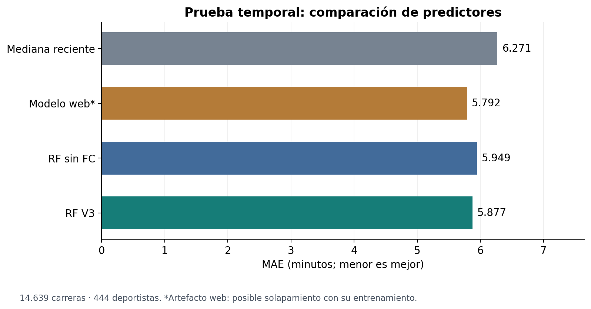
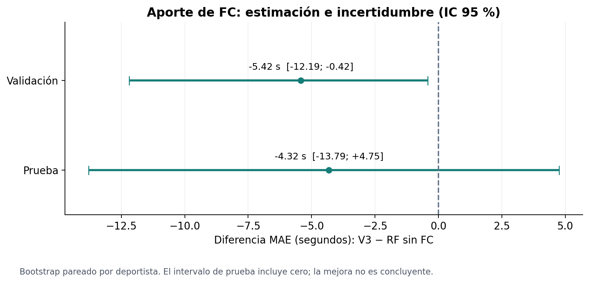
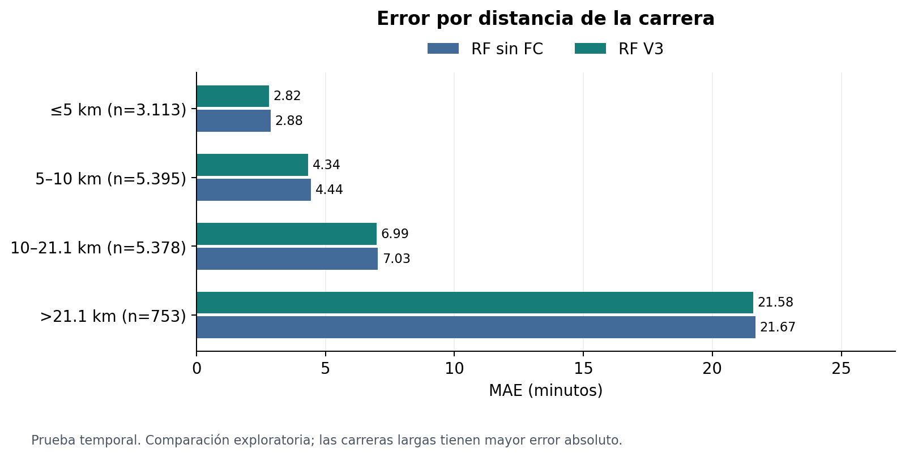
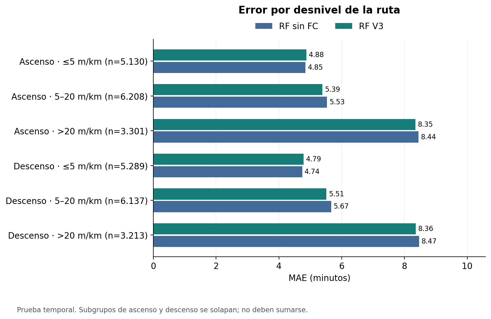
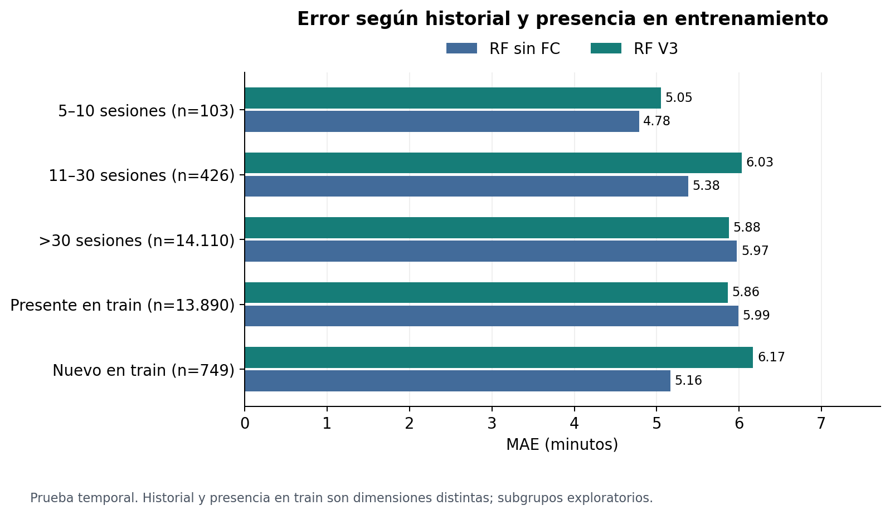
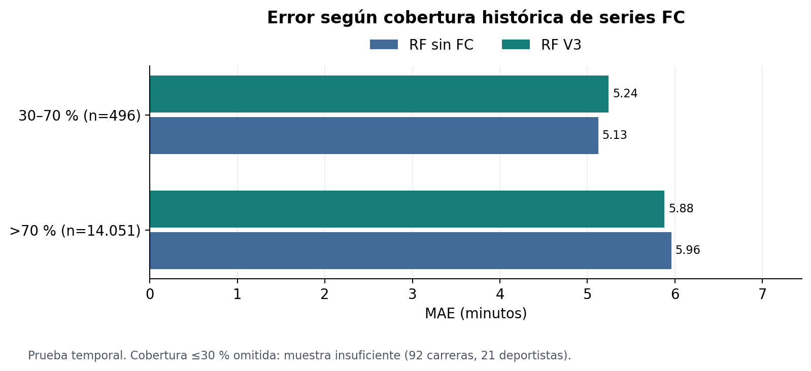

# Figuras de la evaluación temporal

Fuente: [informe agregado](../informe_temporal.json). [Tablas y protocolo](../comparacion_temporal.md). Las figuras son reproducibles con [generar_graficas.py](../../modelo_fc_temporal/generar_graficas.py).

## Comparación global



## Incertidumbre del aporte de frecuencia cardíaca



## Rutas





## Historial y cobertura cardíaca





El V3 mejora ligeramente frente al RF sin FC reentrenado, pero el intervalo global de prueba incluye cero. El análisis por subgrupos es exploratorio; los grupos no son necesariamente disjuntos entre dimensiones. El artefacto web tiene procedencia temporal desconocida.

## Regenerar

Desde la raíz del repositorio, con el entorno Python del experimento instalado:

```powershell
python -m pip install -r .\analisis_datos\modelo_fc_temporal\requirements-graficas.txt
python .\analisis_datos\modelo_fc_temporal\generar_graficas.py
```

No requiere acceso a FitRec ni a exportaciones personales para regenerar las imágenes a partir del JSON agregado.
