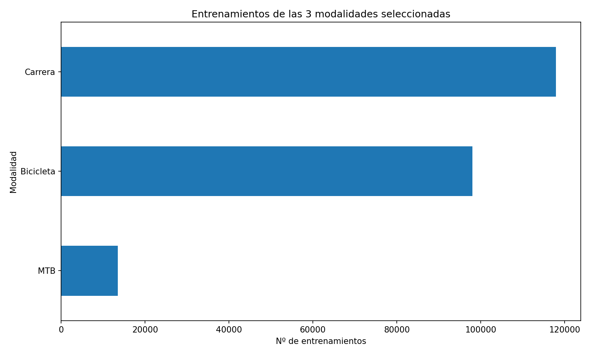
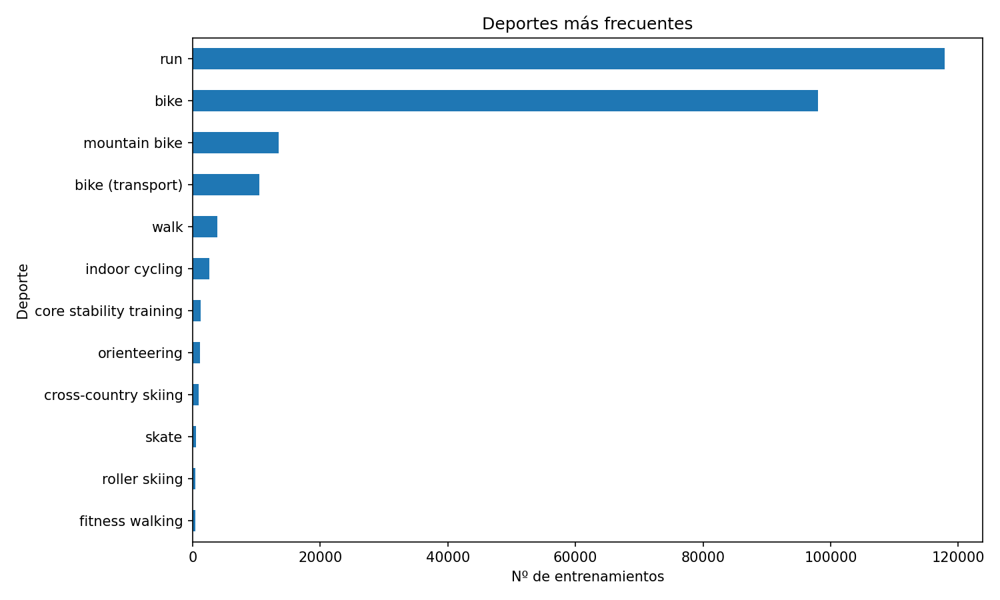
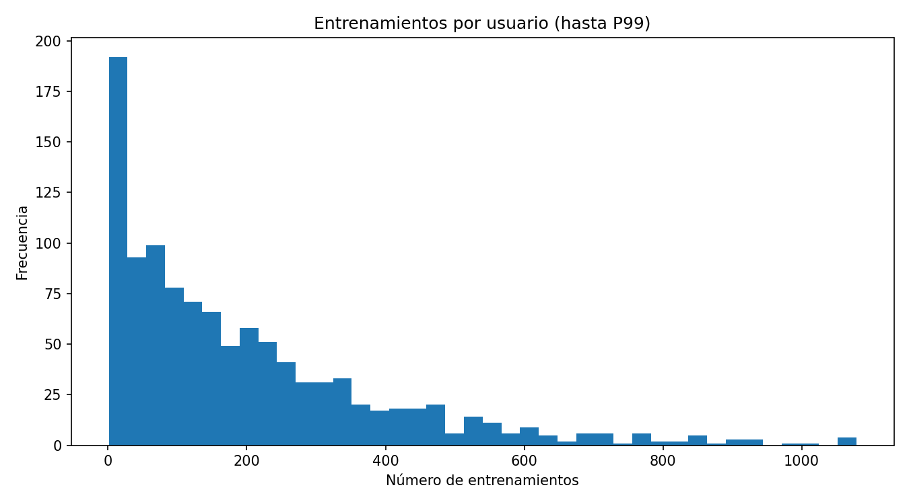
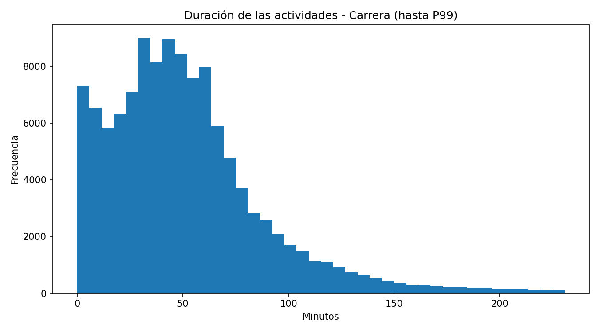
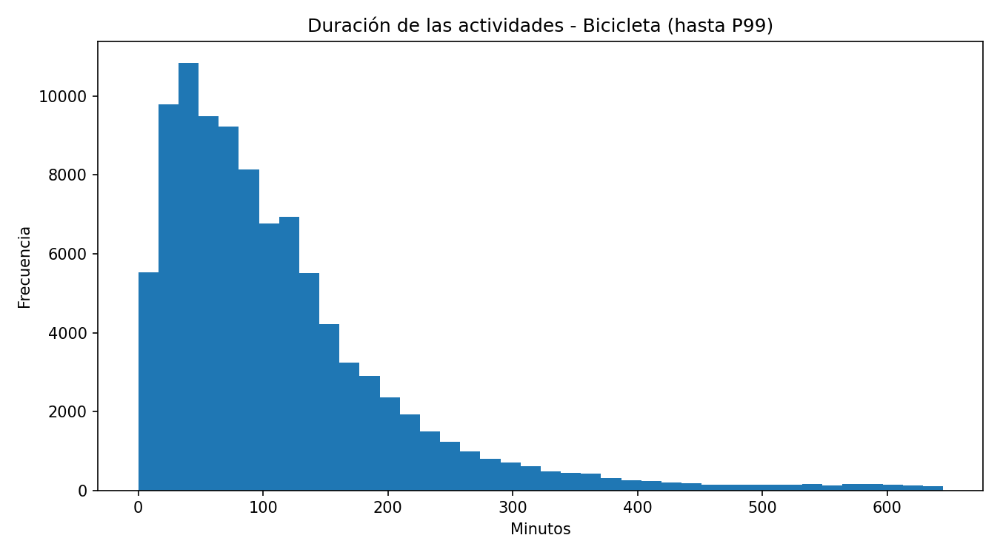
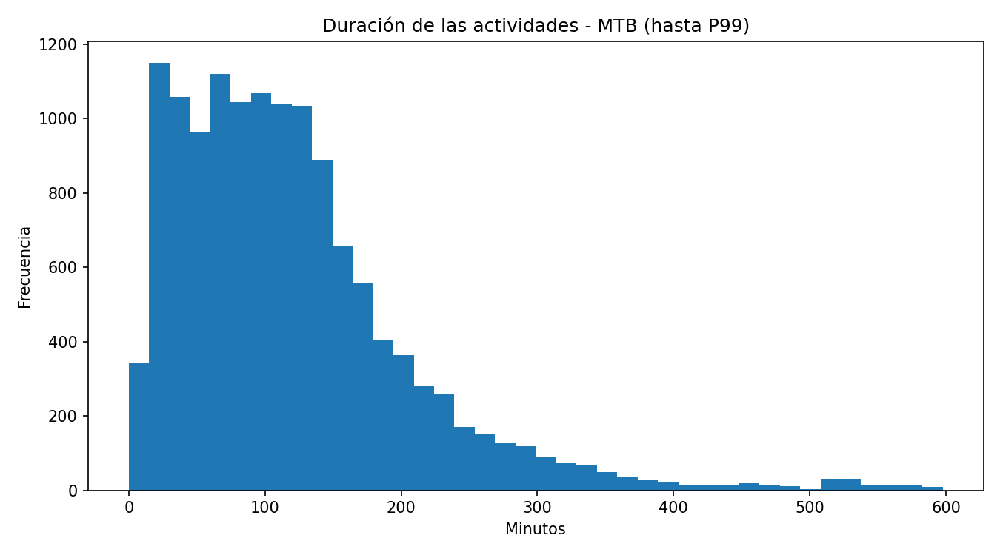
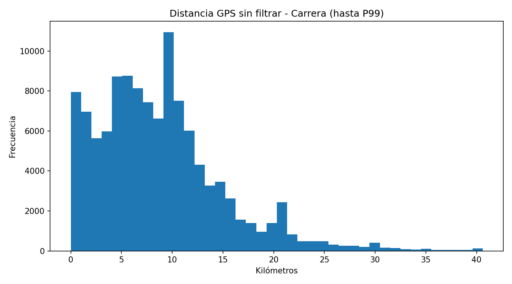
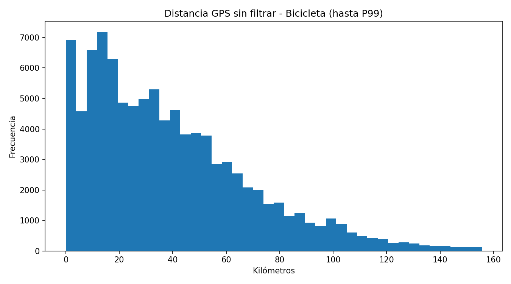
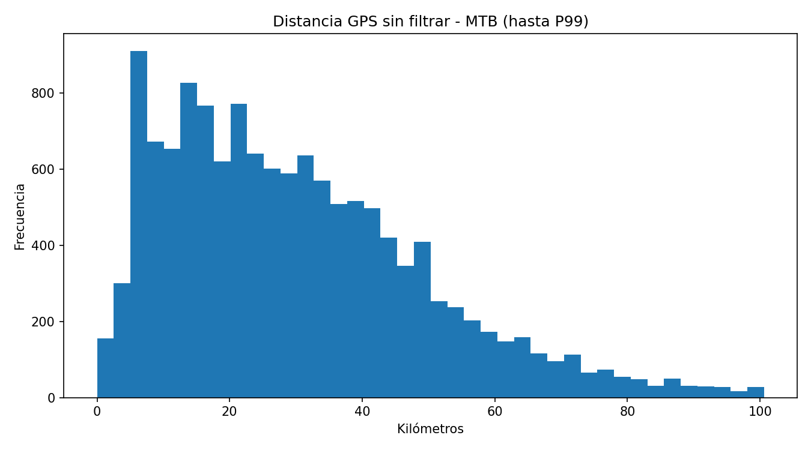

# Informe consolidado de análisis FitRec

**Fecha de los análisis fuente:** 30 de octubre de 2026  
**Fecha de elaboración de este documento:** 3 de noviembre de 2026  
**Fuente:** `endomondoHR.json.gz`  
**Conjunto filtrado:** 229.413 actividades de `run`, `bike` y `mountain bike`

Este documento consolida los informes general, filtrado, de calidad y de series, junto con las gráficas generadas. No se volvieron a ejecutar los análisis para elaborar esta síntesis.

> **Interpretación:** las alertas son indicadores para revisión, no criterios automáticos de exclusión. Las distancias GPS se calcularon sin quitar saltos. La auditoría punto a punto se realizó sobre una muestra dirigida de 536 actividades; sus recuentos no representan tasas del conjunto completo.

## Resumen ejecutivo

- El archivo original contiene **253.020 registros**: **229.413** de carrera, bicicleta o MTB, y **23.607** de otras modalidades.
- El conjunto filtrado comprende **117.902 actividades de carrera**, **98.001 de bicicleta** y **13.510 de MTB**.
- En el análisis filtrado no hubo filas ilegibles, IDs duplicados ni diferencias entre longitudes GPS de latitud y longitud.
- La auditoría de calidad encontró **223 actividades con algún fallo básico** y **3.104 con al menos una advertencia**. Una actividad puede tener varias alertas.
- En la muestra dirigida de series, **65 actividades** tenían intervalos de tiempo no positivos y **223** tenían huecos de más de 10 minutos.
- El análisis detallado de la muestra identificó **11.888 intervalos sospechosos**. No eliminó ni corrigió datos.

## Alcance y distribución

| Modalidad filtrada | Actividades | Porcentaje |
|---|---:|---:|
| Carrera | 117.902 | 51,4 % |
| Bicicleta | 98.001 | 42,7 % |
| MTB | 13.510 | 5,9 % |
| **Total** | **229.413** | **100 %** |

El filtro del análisis filtrado usa las etiquetas exactas `run`, `bike` y `mountain bike`. Por tanto, `bike (transport)`, `indoor cycling` y otros deportes quedan fuera de ese resumen.

En el archivo original se identificaron **1.104 usuarios**; en el filtrado, **1.090**. El máximo fue de **2.905 actividades por usuario** en el archivo original y de **2.903** en el filtrado. En el filtrado, la mediana fue de **139,5 actividades por usuario**, el percentil 90 de **476,1** y el percentil 99 de **1.079**.

### Deportes

### Actividades por usuario

## Duración y distancia

Las gráficas del conjunto filtrado muestran valores hasta el percentil 99 para facilitar su lectura; esto no elimina valores del CSV.

### Duración

### Distancia GPS

Las medianas siguientes se calcularon para las actividades candidatas básicas de la auditoría de calidad:

| Modalidad | Distancia mediana | Duración mediana | Velocidad media derivada mediana |
|---|---:|---:|---:|
| Carrera | 8,06 km | 45,95 min | 10,72 km/h |
| Bicicleta | 32,99 km | 88,60 min | 23,47 km/h |
| MTB | 26,91 km | 104,68 min | 16,80 km/h |
| **Total** | **12,70 km** | **60,10 min** | **12,83 km/h** |

Hay valores extremos en las métricas sin filtrar: la distancia máxima reportada fue de **31.066 km en carrera** y **12.685 km en bicicleta**. También aparecen duraciones negativas y de muchos días. Conviene revisar esos casos antes de usar medias o entrenar modelos; las medianas describen mejor el centro, pero no sustituyen una limpieza validada.

## Disponibilidad de datos

En el conjunto filtrado, las listas de frecuencia cardiaca y altitud aparecen en el **100 %** de las actividades, pero eso no garantiza que cada muestra sea válida. La velocidad original está presente en el **20,2 %**. El GPS está presente en aproximadamente el **99,9 %** de bicicleta y en el **100 %** de carrera y MTB.

## Auditoría de calidad

Los fallos básicos comprueban tiempo, distancia, número de puntos temporales y coherencia de las longitudes GPS. Las advertencias adicionales señalan casos que conviene revisar y no implican necesariamente errores.

| Modalidad | Actividades | Fallo básico | Candidatas básicas | Salto GPS >2 km | Velocidad media sospechosa | Fecha a revisar | Duración >24 h | Alguna advertencia |
|---|---:|---:|---:|---:|---:|---:|---:|---:|
| Carrera | 117.902 | 83 | 117.819 | 174 | 113 | 352 | 66 | 677 |
| Bicicleta | 98.001 | 136 | 97.865 | 1.345 | 21 | 631 | 362 | 2.247 |
| MTB | 13.510 | 4 | 13.506 | 116 | 0 | 25 | 47 | 180 |
| **Total** | **229.413** | **223** | **229.190** | **1.635** | **134** | **1.008** | **475** | **3.104** |

Un salto GPS superior a 2 km no demuestra por sí solo un error: puede corresponder a un hueco temporal o una pausa.

## Auditoría de series: muestra dirigida

La muestra incluyó **536 actividades**: 207 de carrera, 196 de bicicleta y 133 de MTB. Fue seleccionada para revisar alertas y controles, por lo que **no es representativa** para estimar la frecuencia de problemas en todo el conjunto.

| Indicador | Actividades afectadas |
|---|---:|
| Intervalos de tiempo no positivos | 65 |
| Huecos >10 min | 223 |
| Tramos con velocidad sospechosa | 102 |
| Saltos GPS >2 km junto con velocidad sospechosa | 32 |
| Saltos de altitud >100 m | 46 |
| Pulso no plausible | 5 |

## Detalle por intervalos de la muestra

De las 536 actividades, **340** presentaron al menos un intervalo marcado. Se exportaron **11.888 intervalos sospechosos**; un mismo intervalo puede activar varias alertas.

| Tipo de intervalo | Recuento |
|---|---:|
| Timestamps iguales | 104 |
| Tiempo decreciente | 12 |
| Timestamp no finito | 0 |
| Huecos >10 min | 1.208 |
| Saltos GPS >2 km | 182 |
| Velocidad por encima del umbral preliminar | 9.904 |
| Saltos de altitud >100 m | 229 |

Los límites de velocidad de esta revisión son orientativos: **30 km/h en carrera**, **100 km/h en bicicleta** y **70 km/h en MTB**. No son reglas definitivas para eliminar datos.

## Conclusiones y siguientes pasos

1. Revisar actividades con duraciones negativas, muy largas o distancias extremas.
2. Evaluar cada salto GPS junto con el intervalo temporal; no descartarlo solo por su distancia.
3. Definir reglas de limpieza justificadas y medir cuántas actividades conserva cada modalidad y usuario antes de entrenar modelos.
4. Mantener los resultados de la auditoría de series identificados como muestra dirigida, no representativa.

## Informes y datos de auditoría

- [Informe general](./informe_eda_general.md)
- [Informe filtrado](./informe_eda_filtrado.md)
- [Informe de calidad](./informe_calidad.md)
- [Informe de auditoría de series](./informe_series.md)
- [Informe de detalle por intervalos](./informe_detalle.md)
- [Resumen filtrado de actividades](../analisis_datos/resultados_fusionado_20261030/eda_filtrado/resumen_actividades.csv)
- [Actividades que requieren revisión](../analisis_datos/resultados_fusionado_20261030/calidad/actividades_a_revisar.csv)
- [Muestra de auditoría de series](../analisis_datos/resultados_fusionado_20261030/series/auditoria_series_muestra.csv)
- [Detalle de intervalos sospechosos](../analisis_datos/resultados_fusionado_20261030/detalle/detalle_intervalos_sospechosos.csv)

> Los CSV de auditoría contienen identificadores de actividad y usuario. No los publiques en repositorios o servicios públicos sin revisar antes la privacidad.
